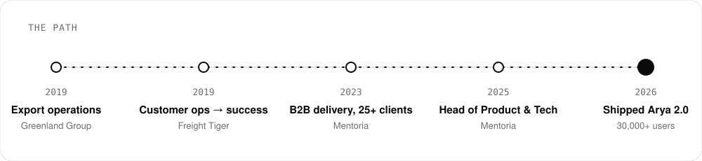

<picture>
  <source media="(prefers-color-scheme: dark)" srcset="assets/header-dark.svg">
  
</picture>

<p align="center">
  <a href="https://sadique.co"></a>
  <a href="https://www.linkedin.com/in/notsadique/"></a>
  <a href="mailto:mdsadiqueh@gmail.com"></a>
  <a href="https://cal.com/sadique/quick-chat-with-sadique"></a>
</p>

<br/>

Hey, I'm Sadique. I build products end to end: the database, the API, the UI, and the product call in between.

I came into engineering through export operations and customer success, so I start from what users actually do. Today I lead engineering on **[Arya](https://arya.mentoria.com)**, an AI job-search agent used by 30,000+ people.

<picture>
  <source media="(prefers-color-scheme: dark)" srcset="assets/divider-dark.svg">
  
</picture>

### `~/now`

> **[Arya](https://arya.mentoria.com)** · AI job search · 30,000+ users
>
> - Sole engineer on 1.0, now leading the 2.0 rebuild with a team of 4
> - Finds relevant jobs, emails recruiters from the user's own Gmail, follows up and tracks replies
> - `Python` `FastAPI` `Next.js` `PostgreSQL` `Supabase` `Celery` `Redis`
>
> **[Read the case study →](https://sadique.co/case-studies/arya)**

### `~/builds`

| Project | What I built | Stack |
|---|---|---|
| **[Zedaire](https://zedaire.com)** | Custom e-commerce platform for a menswear brand: storefront, admin panel and checkout | `Next.js` `Supabase` |
| **[CUKU Cafe](https://www.cukucafe.com)** | Table bookings, a live waitlist queue and an admin panel for a cafe | `Next.js` `Supabase` `Resend` |
| **[M.R. Lights](https://mr-lights.com)** | Shopify store for a lighting showroom, with payments and shipping wired in | `Shopify` `Razorpay` |

### `~/path`

<picture>
  <source media="(prefers-color-scheme: dark)" srcset="assets/journey-dark.svg">
  
</picture>

### `~/stack`

<picture>
  <source media="(prefers-color-scheme: dark)" srcset="https://skillicons.dev/icons?i=python%2Cfastapi%2Cts%2Cnextjs%2Creact%2Ctailwind%2Cpostgres%2Csupabase%2Credis%2Cvercel%2Cfigma&theme=dark">
  
</picture>

<details>
<summary>Full list</summary>
<br/>

| | |
|---|---|
| **Build** | Python · TypeScript · FastAPI · React · Next.js · Tailwind CSS |
| **Data & infra** | PostgreSQL · pgvector · Supabase · Redis · Celery · Render · Vercel · Sentry · Metabase |
| **AI** | OpenAI & Anthropic APIs · LLM classification and extraction · Claude Code · Cursor |
| **Product** | Figma · Linear · Notion · PRDs · product analytics |

</details>

### `~/principles`

```txt
01  start from what users actually do
02  get the base right, keep the product swappable
03  own it end to end: database, UI and the call in between
04  write down what production teaches you
```

### `~/writing`

- **[Tale](https://tale.beehiiv.com)**: reflections on building and working
- **[Substack](https://designbysadique.substack.com/)**: essays on design and product

<picture>
  <source media="(prefers-color-scheme: dark)" srcset="assets/divider-dark.svg">
  
</picture>

<p align="center">
  <a href="https://x.com/notsadique">X</a> ·
  <a href="https://www.instagram.com/astronyxen/">Instagram</a> ·
  <a href="https://dribbble.com/designbysadique">Dribbble</a> ·
  <a href="https://www.behance.net/sadiquehussain">Behance</a>
  <br/><br/>
  <i>"Everything is connected to everything else."</i>
</p>
