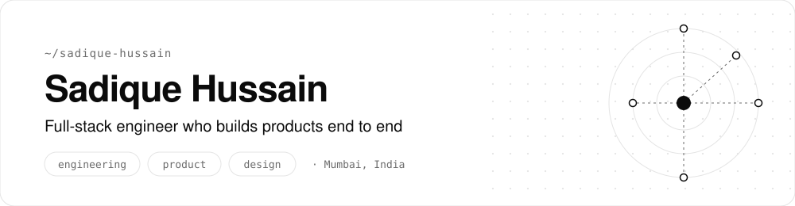

<picture>
  <source media="(prefers-color-scheme: dark)" srcset="assets/header-dark.svg">
  
</picture>

<p align="center">
  <a href="https://sadique.co"></a>
  <a href="https://www.linkedin.com/in/notsadique/"></a>
  <a href="mailto:mdsadiqueh@gmail.com"></a>
  <a href="https://cal.com/sadique/quick-chat-with-sadique"></a>
</p>

<p align="center">
  
</p>

<picture>
  <source media="(prefers-color-scheme: dark)" srcset="assets/divider-dark.svg">
  
</picture>

### `~/now`

**[Arya](https://arya.mentoria.com)** &nbsp;`AI · job search`

Sole engineer on 1.0, now leading the 2.0 rebuild with a team of 4. Arya finds relevant jobs, reaches recruiters from the user's own Gmail, follows up and tracks replies for 30,000+ users.

<sub>Python · FastAPI · Next.js · PostgreSQL · Supabase · Celery · Redis &nbsp;·&nbsp; <a href="https://sadique.co/case-studies/arya">case study →</a></sub>

<sub>Also writing: <a href="https://tale.beehiiv.com">reflections on Tale</a> · <a href="https://designbysadique.substack.com/">essays on Substack</a></sub>

### `~/builds`

<table>
<tr>
<td width="33%" valign="top">

**[Zedaire](https://zedaire.com)**<br/>
<sub>Custom e-commerce platform for a menswear brand: storefront, admin panel, checkout.</sub><br/><br/>
`Next.js` `Supabase`

</td>
<td width="33%" valign="top">

**[CUKU Cafe](https://www.cukucafe.com)**<br/>
<sub>Table bookings, a live waitlist queue and an admin panel for a cafe.</sub><br/><br/>
`Next.js` `Supabase` `Resend`

</td>
<td width="33%" valign="top">

**[M.R. Lights](https://mr-lights.com)**<br/>
<sub>Shopify store for a lighting showroom, with payments and shipping wired in.</sub><br/><br/>
`Shopify` `Razorpay`

</td>
</tr>
</table>

### `~/path`

<picture>
  <source media="(prefers-color-scheme: dark)" srcset="assets/journey-dark.svg">
  
</picture>

### `~/stack`

<p>
  
  
</p>

<details>
<summary><sub>full list</sub></summary>
<br/>

| | |
|---|---|
| **Build** | Python · TypeScript · FastAPI · React · Next.js · Tailwind CSS |
| **Data & infra** | PostgreSQL · pgvector · Supabase · Redis · Celery · Render · Vercel · Sentry · Metabase |
| **AI** | OpenAI & Anthropic APIs · LLM classification and extraction · Claude Code · Cursor |
| **Product** | Figma · Linear · Notion · PRDs · product analytics |

</details>

### `~/principles`

```txt
01  start from what users actually do
02  get the base right, keep the product swappable
03  own it end to end: database, UI and the call in between
04  write down what production teaches you
```

<picture>
  <source media="(prefers-color-scheme: dark)" srcset="assets/divider-dark.svg">
  
</picture>

<p align="center">
  <sub>
    <a href="https://x.com/notsadique">X</a> ·
    <a href="https://www.instagram.com/astronyxen/">Instagram</a> ·
    <a href="https://dribbble.com/designbysadique">Dribbble</a> ·
    <a href="https://www.behance.net/sadiquehussain">Behance</a> ·
    <a href="https://tale.beehiiv.com">Tale</a> ·
    <a href="https://designbysadique.substack.com/">Substack</a>
  </sub>
  <br/><br/>
  <i>"Everything is connected to everything else."</i>
</p>
